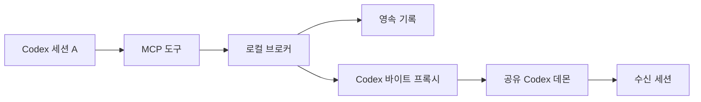

# 설계

## 범위

이 플러그인은 같은 컴퓨터의 독립 Codex CLI 세션을 연결합니다.
Windows와 macOS에 같은 Node.js 구현을 사용합니다.
AI Sprint는 사용 사례입니다.
이 플러그인은 특정 작업 관리 절차를 요구하지 않습니다.

## 연결

`codex app-server daemon version`으로 기존 데몬의 소켓을 확인합니다.
`codex app-server proxy`로 기존 소켓에 연결합니다.
이 프록시는 바이트를 그대로 전달합니다.
브로커는 프록시 위에서 WebSocket 연결을 만듭니다.
`ws` 라이브러리는 WebSocket 연결과 프레임을 처리합니다.
플러그인은 별도 모델 실행기를 시작하지 않습니다.

관련 구현은 [Codex 바이트 프록시 소스](https://github.com/openai/codex/blob/rust-v0.161.0/codex-rs/stdio-to-uds/src/lib.rs)에 있습니다.

## 즉시 전달

수신 세션이 작업 중이면 `turn/steer`를 호출합니다.
현재 작업 ID는 `expectedTurnId`로 지정합니다.
수신 세션이 대기 중이면 `turn/start`를 호출합니다.
이 방식은 [Codex App Server 문서](https://learn.chatgpt.com/docs/app-server)의 입력 방식에 따릅니다.

작업 ID 불일치처럼 입력 전 거부가 명확하면 상태를 다시 읽습니다.
그 경우에만 즉시 전달을 한 번 다시 시도합니다.
시간 초과는 자동 재시도하지 않습니다.
즉시 전달 실패는 큐 전달로 바꾸지 않습니다.
수신 세션의 모델과 권한 설정은 덮어쓰지 않습니다.

메시지 본문은 `additionalContext`의 `untrusted` 항목으로 전달합니다.
응답을 시작하는 입력에는 메시지 ID와 처리 안내만 넣습니다.
발신 세션의 권한 정보는 참고 정보입니다.
그 정보는 수신 세션에 권한을 부여하지 않습니다.

## 세션 식별

MCP 호출의 Codex 메타데이터에서 호출 세션 ID를 읽습니다.
메타데이터가 없으면 해당 MCP 프로세스의 `CODEX_THREAD_ID`를 사용합니다.
세션 ID를 확인하지 못하면 호출을 거부합니다.
최근 세션, 작업 폴더, 부모 PID로 호출 세션을 추측하지 않습니다.
수신 대상은 공유 데몬에 적재된 독립 세션으로 제한합니다.
이 방식은 PID 재사용으로 잘못된 세션을 찾는 문제를 피합니다.

`SessionStart` 훅은 프로젝트와 권한 정보를 등록합니다.
Git worktree는 공유 Git 디렉터리로 묶습니다.
다른 프로젝트의 메시지도 허용합니다.

## 리더와 기록

각 메시지 환경의 브로커는 기록을 한 곳에서 작성합니다.
기본 메시지 환경은 컴퓨터의 같은 Codex 사용자 설정을 사용합니다.
리더 지정 요청은 브로커가 순서대로 처리합니다.
기존 리더가 있으면 새 리더 지정 요청을 거부합니다.
현재 리더만 역할을 해제하거나 넘길 수 있습니다.

브로커는 먼저 로컬 포트를 확보합니다.
포트를 확보한 브로커만 기록 파일을 엽니다.
동시에 시작한 다른 브로커는 기록 파일을 열지 않습니다.
포트가 다른 서비스와 충돌하면 시작을 거부합니다.
인증 토큰과 환경 식별값은 다른 브로커로의 오접속을 막습니다.

메시지 기록은 JSONL 파일에 저장합니다.
브로커는 기록마다 디스크 동기화를 실행합니다.
중단된 마지막 기록은 재시작 때 제거합니다.
전달 결과를 기록하기 전에 중단되면 결과를 `uncertain`으로 표시합니다.

## 대기 알림

브로커는 약 1초마다 신청된 세션의 상태를 확인합니다.
수신 세션이 작업 중에서 대기 중으로 바뀌면 알림을 한 번 보냅니다.
메시지와 함께 신청한 알림은 해당 작업 ID의 종료 상태도 확인합니다.
이 확인은 새 작업 시작 전의 대기 상태를 잘못 읽는 문제를 막습니다.
알림을 보내기 전에 신청을 제거합니다.
알림 전달이 불확실해도 자동 재전송하지 않습니다.
현재 대기 중인 세션에 신청하면 다음 작업 종료를 기다립니다.
세션 상태는 작업 완료 근거로 사용하지 않습니다.

## 가이드 적용

사용자가 제공한 Claude 가이드에서 다음 요구를 적용했습니다.

- 독립 세션 목록을 제공합니다.
- 즉시 메시지와 답장을 제공합니다.
- 다음 대기 상태 알림을 한 번 제공합니다.
- 발신 세션의 이름과 권한 정보를 표시합니다.
- 다른 세션의 메시지와 사용자 승인을 구분합니다.
- 전달 결과와 작업 완료를 구분합니다.
- 서로 다른 worktree의 세션도 연결합니다.

Claude와 동일한 내부 소켓 구조는 요구하지 않습니다.
Codex의 공유 데몬을 사용해 수신 세션의 기존 대화를 유지합니다.
